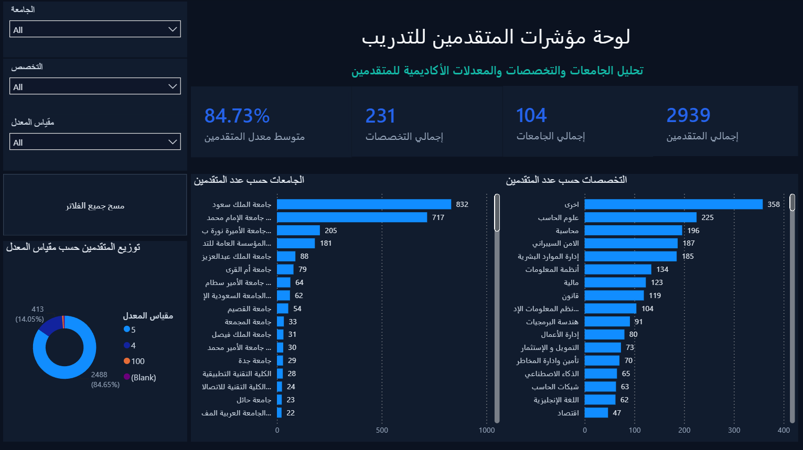
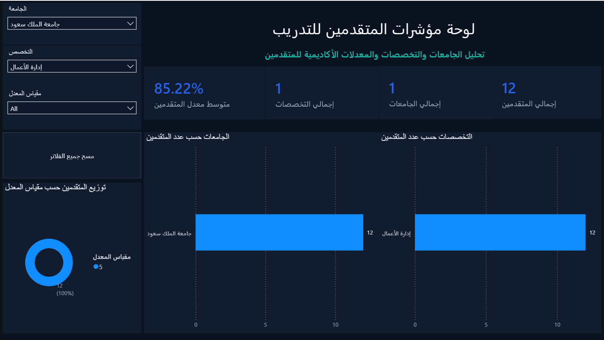
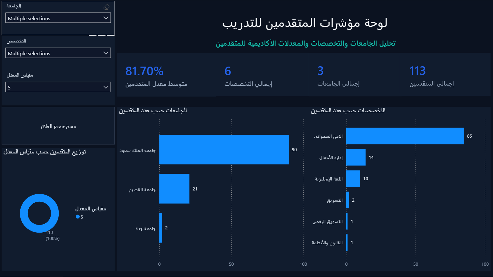

# Training Applicants Dashboard | لوحة مؤشرات المتقدمين للتدريب

An interactive Power BI dashboard built during my cooperative training at the Saudi Data & AI Authority (SDAIA) Academy to explore training-applicant data by university, specialization, and GPA scale.

**[View the dashboard walkthrough](https://1light-9.github.io/Training-Applicants-Dashboard/)**

## Purpose

Applicant records came with inconsistent formats, especially GPAs recorded on different scales. The goal was to turn this data into a clear, filterable view that management could review quickly.

## What the dashboard shows

| Element | Description |
|---|---|
| KPI cards | Total applicants, total universities, total specializations, and average GPA (normalized to a percentage) |
| Applicants by university | Bar chart ranked by number of applicants |
| Applicants by specialization | Bar chart ranked by number of applicants |
| Applicants by GPA scale | Donut chart showing the 4-, 5-, and 100-point scales |
| Slicers | University, specialization, and GPA scale, with a "clear all filters" button |

Scale of the analysis: about 2,900 applicant records covering 100+ universities and 230+ specializations.

## My role

I worked on this project individually. I:

- Cleaned and validated the applicant data in Excel and Power Query.
- Standardized GPAs recorded on 4-, 5-, and 100-point scales into one normalized percentage for comparison.
- Built the measures, visuals, and slicers in Power BI.
- Presented the dashboard to management and refined the layout and visuals based on their feedback.

## Tools

Microsoft Excel, Power BI (Power Query, DAX measures).

## Screenshots

| Overview | One university and specialization | Compare a group |
|---|---|---|
|  |  |  |

## Data and privacy

The original data belongs to SDAIA and is **not included** in this repository. Screenshots show aggregated counts only; no individual applicant information is displayed.

## Notes and limitations

- The average GPA combines three scales after conversion to a percentage. It is meant for overview, not for exact academic comparison between applicants.
- A large share of records fall under an "Other" specialization group.
- This is a training project, not a production reporting system.

---

## نبذة بالعربية

لوحة مؤشرات تفاعلية بُنيت باستخدام Power BI أثناء تدريبي التعاوني في أكاديمية سدايا، لاستعراض بيانات المتقدمين للتدريب حسب الجامعة والتخصص ومقياس المعدل. عملت على المشروع بشكل فردي: نظّفت البيانات وتحققت منها، ووحّدت مقاييس المعدل (4 و5 و100) إلى نسبة مئوية معيارية، وبنيت المؤشرات والرسوم والفلاتر، ثم عرضت اللوحة على الإدارة وحسّنتها بناءً على الملاحظات. البيانات الأصلية غير مرفقة، والصور تعرض أرقامًا مجمّعة فقط.
